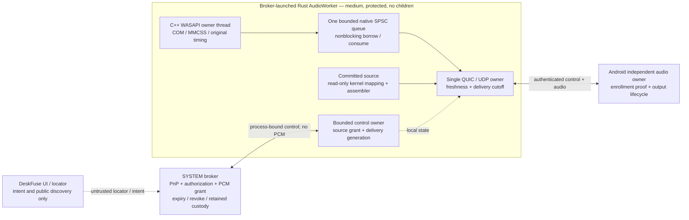

# Native audio ownership — focused Ultra decision and High handoff

**Current implementation, 29 October 2026:**
[Native_Worker_Thread_Launch_High_Decision.md](Native_Worker_Thread_Launch_High_Decision.md)
records the accepted/implemented private-token thread policy and N1 bootstrap.
Continue N2–N6 below. Installed isolation/audio qualification remains open.

**Current E5 prerequisite, 29 October 2026:** finish the persistence correction in
[Enrollment_Durable_Completion_High_Handoff.md](Enrollment_Durable_Completion_High_Handoff.md)
before live enrollment/native-authority integration. It preserves every source,
delivery, performance and rundown decision below. Production authority remains
blocked; this audio plan has not been implemented merely by resolving durability.

**29 October 2026. Planning only.** This resolves the native-worker integration
stop encountered during E1–E6. No runtime source, builds, tests, key creation,
installation, service configuration or hardware operations were performed in
this decision pass. Architecture v0.6, the enrollment-bootstrap handoff and the
completed media optimizations remain in force.

Baseline: `experiment/vnext-audio-latency`, HEAD
`2f181cf2da9c4efdde3013b115108ecac650d1ab`, **plus existing uncommitted work**.
This is a focused refinement of E6 and its E2 deployment dependencies, not a
replacement architecture or permission to discard previous source.

## 1. Decision

**The protected native audio worker is Rust, launched directly by the broker.
It owns the source binding, QUIC connection and UDP egress. Keep its no-children
profile. Reuse the C++ capture/period implementation through the installed DLL.**

The committed path already has this process layout. The fallback will use one
in-process native capture queue instead of a C++ child, pipe writer, anonymous
PCM pipe and Rust pipe-reader queue. The privileged service remains the owner of
PnP, protected authority records, policy admission and kernel PCM grant creation.
It never forwards PCM or parses TLS/QUIC.

Keep a stable source and a replaceable delivery binding. Normal renewal extends
authority without restarting healthy source/QUIC/AAudio. A short reconnect may
retain the source under valid authority and bounded grace; it cannot reuse old
delivery authority or replay queued audio.

Use the existing product device identity and permissions throughout. No display,
application process or video decoder is moved into this audio worker. Browser,
terminal and other provider decisions are unchanged.

## 2. Repository evidence and consequences

| Evidence in current source | Consequence |
|---|---|
| `direct_sender.rs:36–105` and `committed_source.rs:38–77` already combine mapped PCM, assembly, freshness, quiche and UDP in Rust. `source_control.cpp:20–68` owns its COM/period objects on its native thread. | Preserve this implementation and its threading. There is no reason to move audio through C# or another service. |
| `NativeAudioProcess.cs:49–65` launches the lab/session executable. `wasapi_pipe.rs:338–391` launches the C++ capture child. No production native entrypoint accepts the protected registration bootstrap. | Add a fixed Rust product entrypoint and a real broker client; this is source work, not just deployment configuration. |
| `BrokerWorkerLauncher.cs:86,239–243` supplies the registration argument and prohibits children. | Keep the launcher restriction. Do not authorize the Rust worker to spawn arbitrary helpers or ordinary applications. |
| `wasapi_capture.cpp:607–765` contains the real conversion, packet positions/QPC, period and discontinuity behavior. `spsc_capture_queue.h:17–106` already has bounded producer storage and an event. | Extract/reuse the capture core; replace its blocking output adapter, not its timing/conversion implementation. |
| `BrokerAuthority.cs:42–54,98–109` bounds proof dispatch; `PcmGrant.cs:14–32` has no running-lease deadline. `session_control.rs:50` is a one-way readiness flag and omits STOP. | Add an explicit live audio grant and native cutoff. Proof validity, endpoint presence, a connected pipe and mTLS do not renew audio authority. |
| `reactor.rs:99–165` intentionally retries an already sealed packet verbatim. | Revoke/expiry must retire old transport/Egress. Purging aged plaintext cannot revoke sealed ciphertext. |
| `NativeAudioProcess.cs:39–61` writes TLS credentials under a directory granting the ordinary user full control. | This remains a development path. New protected authority requires fresh native-owned private keys, not relocated or relabeled legacy PEMs. |
| Current `BrokerEnrollmentRecord.Validate` accepts v1; the new v2 encoder is optional. | E1's byte/proof work is not live v2 authority. E5/E6 must supply committed v2 records, verified subject and root-authenticated challenge production together. |

The High pause was justified. The original handoff specified a protected native
profile, but did not select its executable or reconcile the child-based fallback.
This document supplies those missing implementation contracts.

## 3. Concrete ownership and entrypoint

Add an explicitly packaged `DeskFuse.AudioWorker.exe` Cargo binary in the
existing `quiche-lab` package. Its Windows entrypoint accepts exactly the generated
`--deskfuse-broker-registration=<N-format UUID>` argument. No `session-stdin`,
certificate path, source DLL path, endpoint, executable, duration or arbitrary
JSON command line is accepted by this production role. Share the existing Rust
server/media code; do not fork a second implementation of the hot path or rewrite
the Android client/lab executable wholesale.

E2's approved installed RX closure includes the worker, the exact C++ DLL and all
actual runtime dependencies. `IInstalledBrokerWorkerImage` gets a concrete fixed
audio profile backed by retained deployment custody. Resolve the DLL from that
profile, with restricted loader search. A path received from the old agent is
never its installed-image approval.

Use the existing SYSTEM-created suspended launch, job-at-creation containment,
sanitized environment, exact logon/process identity and reserved control pipe.
The Rust pipe client opens the explicit client mask, checks the actual SYSTEM
server descriptor and absence of untrusted server-instance rights, and binds to
the service incarnation. A broken established control channel is terminal: no
reconnection by registration UUID. Service death kills the job; unexpected worker
death closes authority and invokes the existing rundown/recovery path.

Inside the worker, one concrete `WindowsAudioOwner` owns zero/one source and
zero/one delivery. It serializes lifecycle transitions. A bounded control reader
signals it through a Windows event; setup/crypto/COM work occurs off its realtime
packet path. Network/control parsing remains bounded and nonprivileged. The
independent Android speaker owner issues renewals and handles output changes;
workspace/video UI lifetime is not the audio issuer lifetime.

An ordinary C# UI/locator may relay public intents, descriptors and signatures.
It supplies no secret, approval boolean, worker PID, grant deadline or media-ready
authority. Once started, the worker and Android audio owner exchange authenticated
control directly; renew/reconnect must not depend on a live workspace or inherited
C# stdin. Discovery addresses remain untrusted hints.

## 4. Source, delivery and the running grant

Use **one source parent, zero/one delivery child, and one shared authority
deadline**, rather than two independently renewable leases or a universal lease
framework. Both typed resources use the existing `Speaker` scope.

| Value | Meaning and rule |
|---|---|
| `SourceGrantId` + `SourceOwnerGeneration` | Broker-created UUID and nonzero u64 for this source authorization/incarnation. Never reconstructed from an enrollment receipt. |
| Source resource digest | SHA-256 of canonical `DeskFuse.Audio.Source.v1\0` data: grant ID, protected peer/device association, subject/worker/profile, selected owned-speaker backend, format/period policy and bounded duration/grace policy. |
| Exact source binding | Service-observed owned PnP device, resolved MMDevice endpoint, actual source identity/ABI and native source incarnation. Bind once preparation completes; record its canonical digest. No default-device/name search or network-supplied endpoint substitutes for these observations. |
| `PcmGeneration` | Kernel mapping/export generation. It is distinct from source-owner, delivery and Android-output generations. Preserve ABI 2 and current required consumer rights initially. |
| Delivery resource digest | SHA-256 of canonical `DeskFuse.Audio.Delivery.v1\0` data: parent grant/digest/generation, exact source-binding digest, worker registration, delivery generation, wire context, actual native and phone TLS certificate hashes, fresh request/native nonces, ALPN and destination policy. |
| `AuthorityUntil` | Absolute Windows suspend-inclusive boot-clock cutoff, shared by source and its current delivery. A delivery cannot outlive its parent. |
| `ControlRevision` | Monotonically increasing u64 for applied owner state. Late/duplicate messages cannot extend or replace newer state. Never wrap counters. |
| `DeliveryGeneration` | Changes on new QUIC connection/keys. It is a control binding distinct from the source timeline; stale connection work cannot enter the replacement. |
| Wire source context / packet sequence | Owned by the source lifecycle. Retain valid source epoch/stream/format and source-frame/packet-sequence continuity through delivery-only reconnect. A new source gets a fresh explicit context instead of hardcoded epoch 1. Never truncate a u64 generation into a wire field or wrap counters. |

Reuse the bootstrap's canonical integers/UUIDs, bounded fields and SHA-256 rules.
Source/delivery descriptors are typed, domain-separated preimages; Android
recomputes their digest before signing a v2 proof. Keep control frames at 8 KiB;
send bounded certificate/descriptor records separately rather than one oversized
message. No PCM goes through these records.

**Preparation is not an endpoint substitution loophole.** Source Acquire approves
the exact broker-owned speaker intent before creating its PnP device. Windows
endpoint/source IDs not yet available are resolved only from that owned device.
The resulting binding digest becomes part of Delivery approval before any media
egress. No authority to capture a physical/default endpoint is inferred.

Keep the existing 32-hex-character PnP device-key format separate from the new
32-byte protected peer identity. Allocate a service-owned 16-byte speaker device
key and persist its exact peer/subject/namespace association. It is an identifier,
not a bearer credential. Retain that association for trusted enrollment replacement;
never adopt a legacy devnode merely because its name matches. This preserves the
current native/device ABI without truncating the authority identity into a peer.

The current `(Identity, Scope, OwnerGeneration)` resource list does not enforce a
parent. Add a **concrete audio-owner record** and check current parent state,
generation, deadline and revision at actual delivery dispatch/rundown admission.
A matching hash alone is insufficient. Keep expensive verification outside the
short authority gate; do not hold that gate across PnP, COM, signing or joins.

### Operations

1. **Acquire source:** a fresh v2 device proof authorizes the fixed source intent
   and bounded policy. Start the owned device/source preparation. Late setup must
   recheck the same live grant before period activation, handle grants and result
   publication; a completion after cancellation cannot resurrect it.
2. **Attach first delivery:** verify a device-proved Delivery descriptor tied to
   the live prepared parent and actual connection. Publish the binding, then admit
   media only after authenticated receiver readiness for that binding/output.
3. **Renew:** a fresh proof names the unchanged current Delivery digest, which
   commits its source parent. Its typed semantics renew that exact source/delivery
   pair. Recheck enrollment, subject/logon, worker, parent, delivery, policy and
   revision, then atomically advance the shared deadline/revision. No healthy
   source, connection or renderer is restarted.
4. **Detach/reconnect:** close delivery first and destroy its transport queues.
   Retain the source only until `min(AuthorityUntil, lostAt + approvedGrace)`.
   Continue consuming/acknowledging and discarding undeliverable source material;
   do not accumulate a reconnect backlog. No renewal occurs while disconnected.
5. **Supersede delivery:** a fresh proof binds new connection/keys/generation to
   the still-live parent before grace/cutoff. It may renew the shared deadline
   under the same bounded policy. Preserve healthy source/endpoint/period and
   actual source positions. Expired or terminal parents require new Acquire.
6. **Change backend/source:** close old delivery, join/revoke old acquisition,
   advance source incarnation and obtain fresh proof/binding. An allowed fallback
   need not prompt the user again, but its provenance cannot silently change and
   it cannot inherit a stale source/delivery proof. Preserve PnP only while its
   existing presence owner remains valid and old acquisition rundown is confirmed.
7. **Stop/expire/revoke:** close admission, retire delivery, revoke kernel export,
   stop/join capture or terminate/join the exact worker job, then apply the existing
   endpoint-reaping policy. Failed rundown is Quarantined with retained custody.

An OutputReady/OutputChanged message is an authenticated lifecycle signal, never
a grant or renewal. It names current delivery and output incarnation. The old
agent's `media-ready` stdin command cannot enable the new authority path.

### Deadline and receipt rules

Proof challenge expiry remains dispatch freshness; the existing 120-second proof
ceiling and 1800-second lab duration are not audio lease lengths. The typed source
policy explicitly bounds runtime duration and reconnect grace. Select/qualify
those product-policy values separately; they are not latency acceptance targets.

For each proof nonce, freeze the exact pending operation, policy, expected revision
and proposed runtime cutoff at **challenge issuance**. Retries or delayed proof
arrival cannot recalculate `now + duration`. Dispatch uses that retained request,
not a second set of network parameters. Reject a deadline already elapsed. A
renewal that is not newer cannot lengthen current authority.

The native worker accepts absolute cutoffs only from its bound SYSTEM control
channel, for its current boot/grant/source/delivery context and a newer revision.
Add a typed host-signed audio-grant receipt from the broker-owned committed
operation record for Android: bind host/namespace/enrollment, service boot, worker,
source grant/generation/digest, delivery digest/generation, revision, cutoff,
proof-transcript hash and fresh phone request nonce. Include authenticated
remaining validity sampled for that reply; cache exact receipt retransmissions.
There is no arbitrary-data signing endpoint.

Windows broker/native use `QueryInterruptTimePrecise` (100-ns boot units); proof
milliseconds are an explicit conversion of this authority clock. Keep source QPC
timestamps and presentation correlation separate. Android uses suspend-inclusive
`elapsedRealtimeNanos` / native `CLOCK_BOOTTIME`. Its conservative local deadline
is anchored to the fresh request-send time plus remaining validity reduced by
qualified clock-rate bounds; delayed replies never start a full new lease.
Recheck on resume before admitting work. Wall clocks and diagnostic clock fitting
do not grant authority.
[Windows clock](https://learn.microsoft.com/en-us/windows/win32/api/realtimeapiset/nf-realtimeapiset-queryinterrupttimeprecise),
[interrupt-time semantics](https://learn.microsoft.com/en-us/windows/win32/api/realtimeapiset/nf-realtimeapiset-queryinterrupttime),
[Android clock](https://developer.android.com/reference/android/os/SystemClock#elapsedRealtimeNanos()).

Service timers/watchdog and native cutoff are separate enforcement mechanisms.
The service cannot claim cleanup complete while a native operation is uncertain;
no kernel-wide lease framework is introduced. Terminal grant state is never
renewed from liveness, a remembered peer, a resumption ticket or transport receipt.

## 5. TLS identity and reconnect control

Generate each production delivery's ephemeral TLS private key in its protected
native owner and retain it in memory. The phone generates its own ephemeral key;
the Windows agent never generates or receives that private key. The broker root
and enrolled signing keys stay separate from TLS.

The pinned dependencies already support this: quiche **0.30.0** defaults to
`boringssl-boring-crate`; Cargo.lock contains **boring 5.3.0**. Use
`Config::with_boring_ssl_ctx_builder`, `set_certificate`, `set_private_key`,
`check_private_key` and the context verification APIs. Add the exact already
locked direct dependency where needed; no TLS backend replacement, quiche fork,
secret temporary files or `/proc`/named-pipe-as-key-file trick is required.
[quiche API](https://docs.quic.tech/quiche/struct.Config.html#method.with_boring_ssl_ctx_builder).

Use a distinct authority-aware ALPN (`df-audio-authority-2`), retaining the current
PCM packet format and timing contracts. The old lab ALPN/credentials do not
authenticate this capability. No 0-RTT mutations or silent v1 downgrade.

For first contact/rebinding, a connection may be **quarantined**: accept only a
bounded single self-signed canonical P-256 candidate certificate and TLS proof of
possession, with no enrolled identity/authorization inferred. Permit bounded
public challenge/descriptor/proof control only. The actual protected native
worker reports the TLS identities observed on that connection through its bound
broker pipe. The root-authenticated v2 challenge and independent phone proof bind
those identities, both fresh nonces and delivery context. Android must compare
the native certificate with its actual TLS peer and the phone certificate with
its own local key before signing. A terminating relay therefore cannot substitute
its own key. This is a per-context quarantine policy, never global trust-all,
CA installation or `verify_peer(false)` on the production media path.

Install delivery only after broker authorization; then require the exact approved
certificates, connection incarnation and receiver readiness. Fresh TLS keys plus
one admitted connection per delivery remove an ambiguous reused-key channel; a
QUIC CID or remote IP is not device authority. No TLS exporter API is required.
Use the current fixed-route policy first; any later same-connection path migration
must be authenticated and admitted by its explicit destination policy.

This control can run over the worker's bounded QUIC control stream: the existing
agent is only an optional locator/relay. Bound provisional connections and pending
attempts per owner, so discovery cannot start unlimited workers, keys or PnP
devices. Established broker-pipe loss remains terminal even if network reconnect
would otherwise be allowed.

## 6. WASAPI fallback: one native queue, no PCM subprocess

Preserve C++ endpoint/format checks, conversion, device-frame positions, original
packet QPC/offset, discontinuity/silent/timestamp-error flags, period policy and
MMCSS. Create/start/service/stop/release WASAPI and COM on the same C++ capture
thread. Rust's QUIC owner neither blocks that thread nor receives its callbacks.
Raw WASAPI buffer pointers never cross the capture thread or outlive ReleaseBuffer.
[GetBuffer](https://learn.microsoft.com/en-us/windows/win32/api/audioclient/nf-audioclient-iaudiocaptureclient-getbuffer),
[ReleaseBuffer](https://learn.microsoft.com/en-us/windows/win32/api/audioclient/nf-audioclient-iaudiocaptureclient-releasebuffer).

Expose a small versioned C ABI in the existing approved source-control DLL:
`open_owned_loopback`, `try_borrow`, `consume`, `request_stop`, `join`, `destroy`,
plus readiness/terminal handles and bounded status. All exports catch exceptions;
no exception/panic crosses FFI. Opening/setup is asynchronous to QUIC. A borrow
returns one immutable published record and token; consume must name that token.
Only one borrow is outstanding per consumer. Join/destroy never invalidate a
borrow or a still-running producer; failure preserves the object for quarantine
or exact-worker termination, not detached-thread/free-and-hope cleanup.

Use the current **eight-slot** preallocated native SPSC storage initially, with
producer reserve/publish and consumer borrow/consume operations. Convert/copy
directly from the WASAPI packet into a reserved native slot. Full means drop new
records without waiting, overwriting a borrowed slot or doing unnecessary
conversion. Preserve drop/frame-gap accounting. Rust feeds the borrowed PCM and
metadata directly to the existing assembler, then consumes immediately. Do not
construct an extra owned CaptureChunk, serialize a pipe header, retain the pointer
across QUIC work or add a second Rust PCM queue.

Use the existing auto-reset event as a wake hint and published indices as truth.
After its bounded queue budget, the Rust owner continues if records remain; it
checks queue/terminal state before sleeping. Do not reset away a producer signal.
One waiter plus the persistent event covers publication between empty-check and
wait. Add control/terminal events and the authority/grace cutoffs to the existing
Windows readiness wait; no polling thread or periodic 2-ms wake is introduced.

Capture waits include cooperative Stop and check it between packet drains. Native
terminal state is published with release/acquire ordering and a wake. Ordinary
completion may drain still-authorized, still-fresh records; revoke/expiry discards
them. Keep diagnostics deferred and capture free of allocation, mutexes, IPC,
filesystem operations and logging per packet.

Committed-source age uses its unchanged original commit/presentation contract
and 60-ms admission limit. WASAPI fallback retains its truthful capture provenance
and existing freshness rules; it must not be advertised as committed-source timing.
Reset only partial assembly/old delivery data at a reconnect fence, not genuine
source positions. Keep the existing committed fresh-anchor proof; for loopback,
recovery must use post-fence original packets, not buffered pre-disconnect slices.

## 7. Cutoff and failure semantics on the actual hot path

All cryptographic checks and SYSTEM IPC remain control work. Reuse one cached
local authority snapshot, terminal flag and generation at bounded owner turns,
before source-side effects, PCM admission, packet construction and actual UDP
submission. This is necessary local admission—not a per-sample policy call,
registry read, signature, storage lookup or new media forwarding stage.

The control reader publishes a terminal fence and wakes the owner immediately;
it cannot wait behind an unbounded UDP drain. Bound network and source work per
turn and service control/expiry first. Include cutoff/grace in wait deadlines and
check the authority clock again after wake, including suspend/resume.

On delivery cutoff, stop servicing its old Egress entirely. Discard the assembler
residue for that delivery, plaintext ledger, pending sealed UDP slot, QUIC
connection and socket association. Do not flush queued media as cleanup. A fatal
QUIC post-enqueue error still retires that connection. Normal authorized
WouldBlock/pacing retries retain exactly the same ciphertext as before.

Revocation acknowledgement follows the owner barrier and required source/native
rundown, not merely enqueueing Stop. A send already admitted immediately before
the fence may finish; UDP already submitted to the kernel/network cannot be
recalled. Receiver Stop closes its own admission/output promptly. No claim of
instant recall or hard realtime cleanup is added.

Keep ABI 2's current bounded RW control handle during this tranche. The kernel
mapping remains read-only to the consumer, and the broker retains the authoritative
owner handle. Native stop reports actual results; the current ignored revoke
result in `Source::stop` cannot certify rundown. Broker `PcmGrant.Dispose` and
retained process/job exit determine confirmed cleanup. A future owner/consumer
rights split is separate driver work, not a prerequisite or implicit ABI change.

## 8. Ordered implementation and qualification

Complete the existing E1–E5 programme under its contracts. Within E2, package the
new fixed Rust role and DLL closure; within E6, use these small increments:

| Increment | Deliverable and exit condition |
|---|---|
| N1 — real worker entry | Fixed Rust entrypoint, installed-image adapter and process-bound pipe client. No source privilege before valid v2 context. Reject arbitrary paths/arguments and established-channel reconnect. |
| N2 — concrete audio authority | Parent/child owner state, typed descriptors, live deadline/revision, typed signed receipt and one-use proof mapping. Keep committed v2 enrollment/subject checks mandatory. No running grant inferred from proof expiry. |
| N3 — native TLS/control | In-memory per-delivery keys, quarantine-to-authorized connection, root/device binding, separate source/delivery generations, authenticated readiness/renew/Stop. No legacy PEM/host-secret trust. |
| N4 — committed integration | Connect service-owned endpoint/PCM grant to the actual worker, preserving mapped source/assembler/age/fence path. Separate transport cleanup from source cleanup; local cutoff suppresses queued ciphertext. |
| N5 — in-process fallback | Reused C++ capture core + nonblocking ABI + one SPSC queue; remove child/PCM pipe from the production role. Preserve old lab path for comparison, not as silent v2 fallback. |
| N6 — renewal/recovery | Healthy repeated renewals; transport loss/rebind with stable source; output-only recovery; expiry/Stop/service death and late setup completion; no generation resurrection. |

Use existing fixtures and a few combined behavior tests, not a new general
framework. Essential offline groups: (1) C#/Rust/Kotlin descriptor and identity
substitution/parent checks; (2) expiry/late renewal/revision/parent lifetime and
setup cancellation; (3) auto-reset wake, borrow lifetime, full queue/gap and
stop/join; (4) revoke while paced/blocked ciphertext is pending, and source kept
through delivery rebind. Run affected builds; no new broad suite for test counts.

Installed-SYSTEM/device qualification is separately authorized work, not performed
by this decision. First prove the actual Rust/DLL combination loads and runs under
the intended token, job, mitigations and retained closure; prove caller/key
isolation against rogue same-user and other-logon code. Then compare matched
committed and loopback workloads against the preserved baseline: original-source
age, admission/packet-build and blocked/pacing dwell, drops/discontinuities,
CPU/wakes, receiver continuity and power. Validate real renew/reconnect and stale
receiver/control races. No arbitrary target permits avoidable work or a regression.

The DEFAULT-only driver candidate, all seven category/RAW cases, committed-export
hardware provenance and normal route/endpoint behavior remain their existing
physical gates. This ownership decision resolves none of them by assertion.

If in-process loading/COM fails under the actual protected profile, retain the
failure evidence and stop for a focused decision. A separately broker-launched
fixed capture companion is a contingency to evaluate, not an automatic fallback
or permission to relax child policy. It adds a second owner and media transfer;
current evidence does not justify paying that cost.

Keep each source increment reversible and the new production authority disabled
until its whole chain qualifies. Rollback disables the new role/capability and
performs confirmed owned rundown; it does not restore trust to legacy keys, adopt
old endpoints, or fall back to v1 on mismatch. Unrelated DPI/video/provider work
does not wait for this qualification. This focused planning pass ends here.
